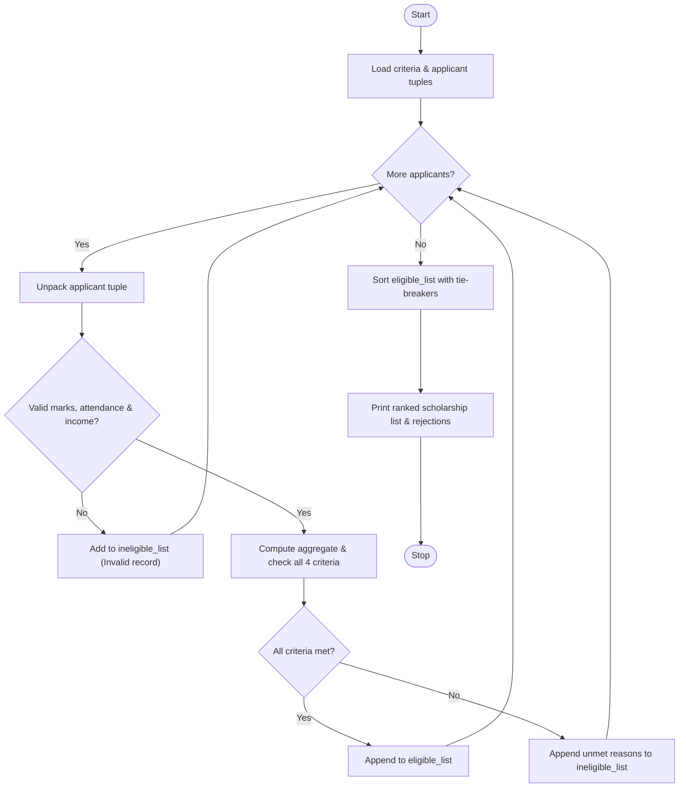
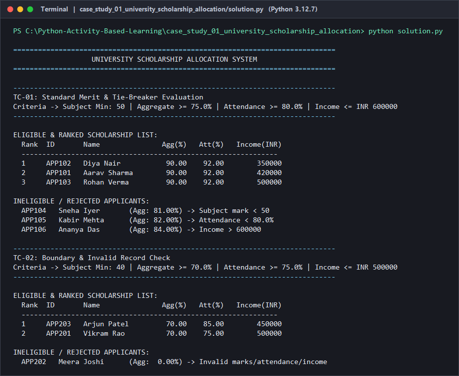

# Case Study 01: University Scholarship Allocation (Question 1)

> **Syllabus Scope:** Variables, Data Types, Operators, Conditional Statements, Loops, Strings, Lists, Nested Lists, Tuples, Tuple Operations, and Tuple Unpacking.

---

## 1. Problem Statement
Design a Python system that evaluates university scholarship applicants using their subject-wise marks, aggregate percentage, attendance percentage, and annual family income. The system must validate input bounds, filter out ineligible applicants with clear reasons, rank all eligible applicants, and resolve tied ranks deterministically using predefined tie-breaking rules.

---

## 2. Objectives
- Validate applicant marks (`0–100`), attendance (`0–100`), and family income (`>= 0`).
- Enforce subject-wise minimum score, minimum aggregate percentage, minimum attendance, and maximum income ceiling rules.
- Record specific rejection reasons for every ineligible applicant.
- Rank qualified candidates using deterministic multi-criteria tie-breaking (aggregate -> attendance -> lower income -> applicant ID).

---

## 3. Assumptions
- Each applicant record is represented as a tuple `(app_id, name, marks_list, attendance_pct, family_income)`.
- All subjects carry equal weight (100 maximum marks per subject).
- An applicant failing multiple criteria has all unmet conditions listed in the rejection report.
- Ranking is performed in-place using a nested-loop bubble sort without external libraries or custom functions.

---

## 4. Algorithm
1. **Start** and load the test case criteria (`min_sub`, `min_agg`, `min_att`, `max_inc`) and applicant records list.
2. Initialize empty lists `eligible_list` and `ineligible_list`.
3. For each applicant tuple `(app_id, name, marks, attendance, income)`:
   - Validate that `marks` is non-empty, each mark is in `0..100`, `attendance` is in `0..100`, and `income >= 0`.
   - If invalid, append an invalid-record entry to `ineligible_list` and continue to the next applicant.
   - Compute `total_marks` and check whether any subject mark is below `min_sub`.
   - Compute `aggregate_pct = total_marks / len(marks)`.
   - Check `failed_subject`, `aggregate_pct < min_agg`, `attendance < min_att`, and `income > max_inc`; append each failed condition to `reasons`.
   - If `reasons` is empty, append `(app_id, name, aggregate_pct, attendance, income)` to `eligible_list`; otherwise join reasons and append to `ineligible_list`.
4. Sort `eligible_list` in descending merit order using bubble sort:
   - Primary key: higher `aggregate_pct`
   - Tie-breaker 1: higher `attendance`
   - Tie-breaker 2: lower `income`
   - Tie-breaker 3: smaller `app_id`
5. Display the ranked eligible table and the rejected applicants list.
6. **Stop**.

---

## 5. Flowchart



---

## 6. Pseudocode

```text
BEGIN
    FOR EACH (min_sub, min_agg, min_att, max_inc, applicants) IN test_cases DO
        eligible_list <- []
        ineligible_list <- []

        FOR EACH (app_id, name, marks, attendance, income) IN applicants DO
            IF marks invalid OR attendance < 0 OR attendance > 100 OR income < 0 THEN
                APPEND (app_id, name, 0.0, "Invalid marks/attendance/income") TO ineligible_list
                CONTINUE
            END IF

            total_marks <- SUM(marks)
            aggregate_pct <- total_marks / LENGTH(marks)
            reasons <- []

            IF ANY mark < min_sub THEN APPEND "Subject mark < min_sub" TO reasons
            IF aggregate_pct < min_agg THEN APPEND "Aggregate < min_agg%" TO reasons
            IF attendance < min_att THEN APPEND "Attendance < min_att%" TO reasons
            IF income > max_inc THEN APPEND "Income > max_inc" TO reasons

            IF LENGTH(reasons) == 0 THEN
                APPEND (app_id, name, aggregate_pct, attendance, income) TO eligible_list
            ELSE
                APPEND (app_id, name, aggregate_pct, JOIN(reasons, "; ")) TO ineligible_list
            END IF
        END FOR

        SORT eligible_list BY (aggregate DESC, attendance DESC, income ASC, app_id ASC)
        DISPLAY eligible_list AND ineligible_list
    END FOR
END
```

---

## 7. Python Source Code
- Source file: [`solution.py`](./solution.py)
- Uses only variables, conditionals, loops, strings, lists, tuples, and tuple unpacking.

---

## 8. Test Cases

| Test ID | Scenario | Input Highlights | Expected Outcome | Verification |
| :--- | :--- | :--- | :--- | :--- |
| **TC-01** | Standard Merit & Tie-Breaker | `APP101`, `APP102`, `APP103` all at `90.00%` agg & `92.00%` att; incomes `420k`, `350k`, `500k`; `APP104` fails subject min; `APP105` fails attendance; `APP106` fails income | Ranked: `APP102` (1), `APP101` (2), `APP103` (3); 3 rejected with exact reasons | Passed |
| **TC-02** | Boundary & Invalid Record | `APP201` exactly on thresholds (`70%`, `75%`, `500k`); `APP202` has mark `105`; `APP203` qualifies with higher attendance (`85%`) | `APP203` ranked 1, `APP201` ranked 2; `APP202` rejected as invalid | Passed |

---

## 9. Output Screenshots



---

## 10. Conclusion
The University Scholarship Allocation system accurately filters applicants against academic, attendance, and financial criteria while preserving auditability for rejected applicants. Deterministic multi-level tie-breaking ensures fair, reproducible ranking using only core Python lists and tuples.
