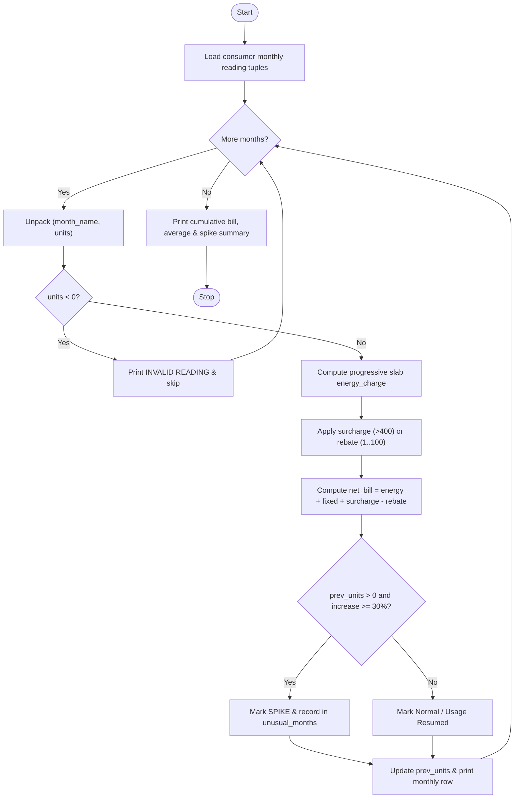
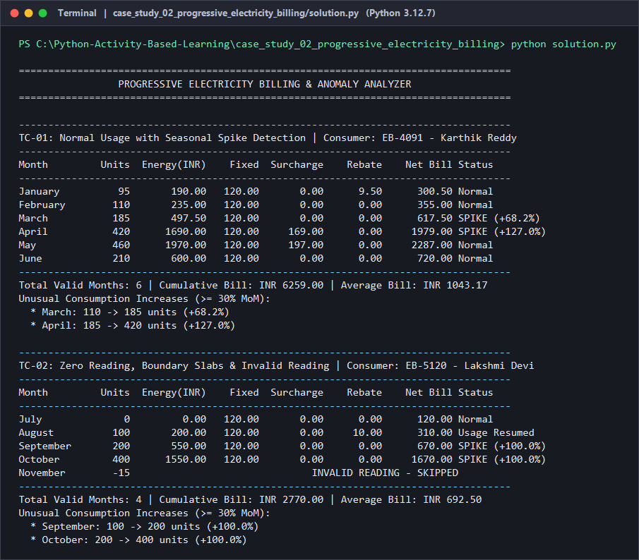

# Case Study 02: Progressive Electricity Billing (Question 2)

> **Syllabus Scope:** Variables, Data Types, Operators, Conditional Statements, Loops, Strings, Lists, Tuples, and Tuple Unpacking.

---

## 1. Problem Statement
Develop a Python application that calculates monthly household electricity bills using progressive unit slabs, fixed meter charges, high-consumption surcharges, and low-consumption rebates. Furthermore, compare consumption across consecutive months to detect and flag unusual increases.

---

## 2. Objectives
- Implement tiered slab-based billing (`0–100`, `101–200`, `201–400`, and `>400` units).
- Apply fixed monthly charges (`INR 120`), high-usage surcharge (`10%` above `400` units), and conservation rebate (`5%` for `1–100` units).
- Validate meter readings to safely skip negative/corrupted values.
- Compute month-over-month percentage changes and flag spikes `>= 30%`.

---

## 3. Assumptions
- Tariff rates: `INR 2.00/unit` (1–100), `INR 3.50/unit` (101–200), `INR 5.00/unit` (201–400), `INR 7.00/unit` (>400).
- Zero-unit consumption incurs only the fixed charge (`INR 120.00`) with no rebate or surcharge.
- Month-over-month comparison compares each valid month against the immediately preceding valid month with positive units.

---

## 4. Algorithm
1. **Start** and initialize constants `FIXED_CHARGE = 120.0` and `SPIKE_THRESHOLD_PCT = 30.0`.
2. For each consumer test case, unpack `(case_title, consumer_id, consumer_name, monthly_readings)`.
3. Initialize `prev_units = -1`, `total_net_bill = 0.0`, `valid_months = 0`, and `unusual_months = []`.
4. For each `(month_name, units)` tuple in `monthly_readings`:
   - If `units < 0`, print an invalid reading notice and skip to the next month.
   - Calculate `energy_charge` progressively across the four unit slabs.
   - Set `surcharge = energy_charge * 0.10` if `units > 400`; set `rebate = energy_charge * 0.05` if `0 < units <= 100`.
   - Compute `net_bill = energy_charge + FIXED_CHARGE + surcharge - rebate`.
   - If `prev_units > 0`, compute `pct_change = ((units - prev_units) / prev_units) * 100.0`; if `pct_change >= 30.0`, flag `"SPIKE"` and record it.
   - Update `prev_units = units`, accumulate `total_net_bill`, and print the monthly row.
5. After the loop, display cumulative bill, average bill, and detected consumption spikes.
6. **Stop**.

---

## 5. Flowchart



---

## 6. Pseudocode

```text
BEGIN
    SET FIXED_CHARGE <- 120.0
    SET SPIKE_THRESHOLD_PCT <- 30.0

    FOR EACH (title, cid, cname, readings) IN test_cases DO
        prev_units <- -1
        total_net_bill <- 0.0
        unusual_months <- []

        FOR EACH (month, units) IN readings DO
            IF units < 0 THEN
                PRINT month, "INVALID READING - SKIPPED"
                CONTINUE
            END IF

            CALCULATE energy_charge USING progressive slabs
            surcharge <- 0.10 * energy_charge IF units > 400 ELSE 0
            rebate <- 0.05 * energy_charge IF 0 < units <= 100 ELSE 0
            net_bill <- energy_charge + FIXED_CHARGE + surcharge - rebate

            IF prev_units > 0 AND ((units - prev_units) / prev_units) * 100 >= SPIKE_THRESHOLD_PCT THEN
                APPEND (month, prev_units, units, pct_change) TO unusual_months
            END IF

            prev_units <- units
            total_net_bill <- total_net_bill + net_bill
            PRINT formatted monthly bill row
        END FOR

        PRINT summary totals and unusual_months
    END FOR
END
```

---

## 7. Python Source Code
- Source file: [`solution.py`](./solution.py)
- Uses only variables, operators, conditional branches, loops, lists, tuples, and tuple unpacking.

---

## 8. Test Cases

| Test ID | Scenario | Input Highlights | Expected Outcome | Verification |
| :--- | :--- | :--- | :--- | :--- |
| **TC-01** | Multi-Month Seasonal Spikes | Units: `95, 110, 185, 420, 460, 210` | Rebate on Jan (`INR 9.50`), surcharges on Apr/May, spikes flagged in Mar (`+68.2%`) and Apr (`+127.0%`); Total `INR 6259.00` | Passed |
| **TC-02** | Zero, Boundaries & Negative | Units: `0, 100, 200, 400, -15` | `0` units -> `INR 120.00`, `100` -> `INR 310.00`, `200` -> `INR 670.00`, `400` -> `INR 1670.00`, `-15` skipped | Passed |

---

## 9. Output Screenshots



---

## 10. Conclusion
The Progressive Electricity Billing system models real-world utility tariff slabs cleanly and safeguards against invalid meter data. Automatic month-over-month anomaly detection highlights sudden consumption jumps for billing verification.
