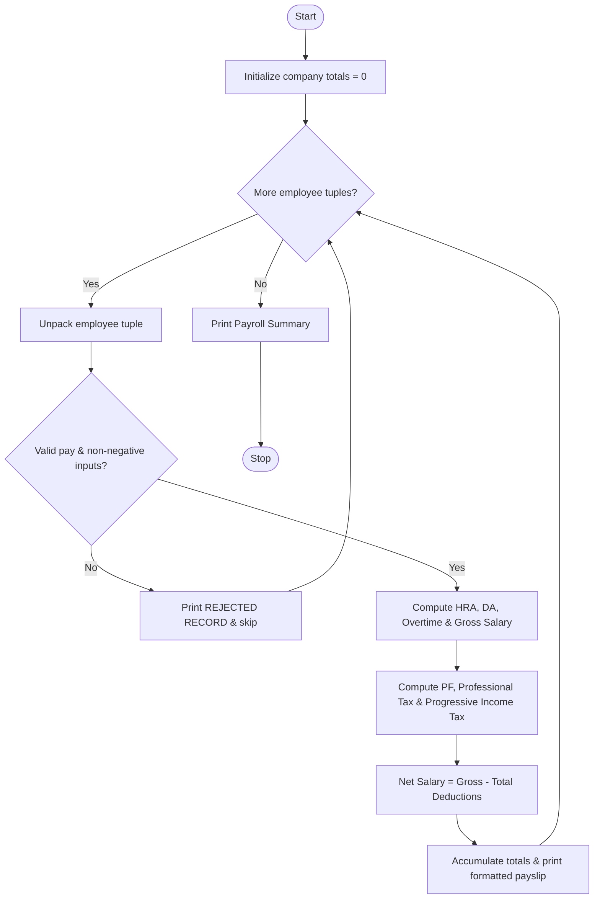
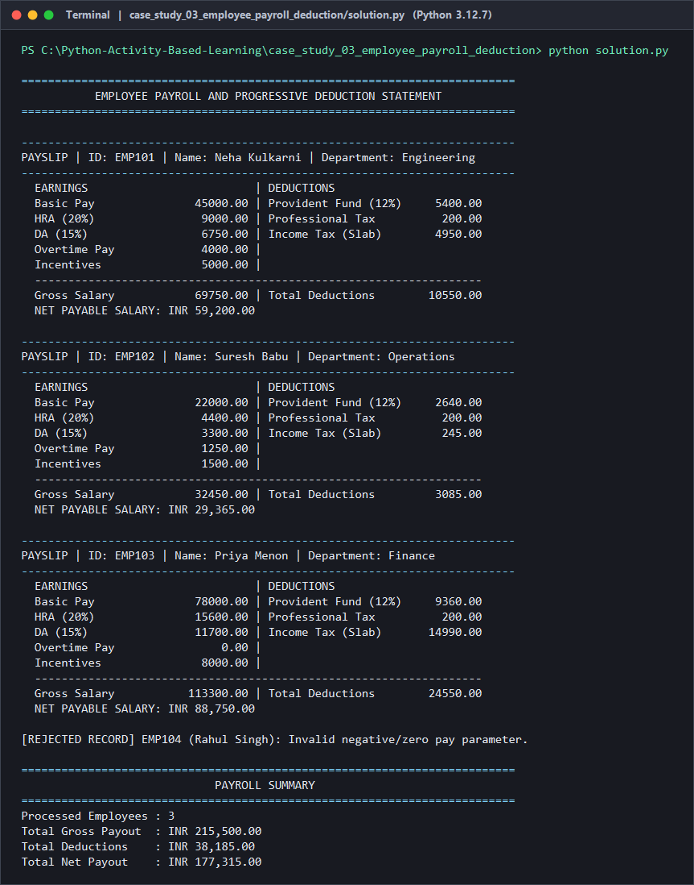

# Case Study 03: Employee Payroll and Deduction Analysis (Question 4)

> **Syllabus Scope:** Variables, Data Types, Operators, Conditional Statements, Loops, Strings, Lists, Tuples, and Tuple Unpacking.

---

## 1. Problem Statement
Build a payroll calculation system that computes employee gross salary from basic pay, allowances (HRA and DA), overtime pay, and performance incentives; applies fixed and progressive income tax deductions; and prints a formatted salary statement alongside a company-wide payroll summary.

---

## 2. Objectives
- Calculate earnings components (`HRA = 20%`, `DA = 15%`, overtime pay, and incentives).
- Apply Provident Fund (`12%` of basic pay), Professional Tax (`INR 200` if gross > `25000`), and progressive monthly income tax slabs.
- Validate employee salary inputs to reject negative or zero basic pay records.
- Generate aligned two-column payslips and aggregate company totals.

---

## 3. Assumptions
- Each employee is stored as a tuple `(emp_id, name, department, basic_pay, ot_hours, ot_rate, incentive)`.
- Monthly progressive income tax slabs on gross salary:
  - `<= 30,000`: `0%`
  - `30,001 – 60,000`: `10%` of amount above `30,000`
  - `60,001 – 1,00,000`: `3,000 + 20%` of amount above `60,000`
  - `> 1,00,000`: `11,000 + 30%` of amount above `1,00,000`
- Invalid records are logged and excluded from company payout totals.

---

## 4. Algorithm
1. **Start** and load the list of employee tuples.
2. Initialize company accumulators (`total_company_gross`, `total_company_deductions`, `total_company_net`, `processed_count`) to `0`.
3. For each employee tuple `(emp_id, name, dept, basic_pay, ot_hours, ot_rate, incentive)`:
   - Validate `basic_pay > 0`, `ot_hours >= 0`, `ot_rate >= 0`, `incentive >= 0`. If invalid, log rejection and `continue`.
   - Compute `hra = 0.20 * basic_pay`, `da = 0.15 * basic_pay`, `overtime_pay = ot_hours * ot_rate`.
   - Compute `gross_salary = basic_pay + hra + da + overtime_pay + incentive`.
   - Compute `pf = 0.12 * basic_pay` and `prof_tax = 200.0` if `gross_salary > 25000.0` else `0.0`.
   - Compute `income_tax` using the progressive bracket conditions.
   - Compute `total_deductions = pf + prof_tax + income_tax` and `net_salary = gross_salary - total_deductions`.
   - Update company accumulators and print the formatted payslip.
4. Print the overall `PAYROLL SUMMARY`.
5. **Stop**.

---

## 5. Flowchart



---

## 6. Pseudocode

```text
BEGIN
    SET total_gross <- 0, total_ded <- 0, total_net <- 0, count <- 0

    FOR EACH (emp_id, name, dept, basic, ot_hrs, ot_rate, incentive) IN employees DO
        IF basic <= 0 OR ot_hrs < 0 OR ot_rate < 0 OR incentive < 0 THEN
            PRINT "REJECTED RECORD", emp_id
            CONTINUE
        END IF

        hra <- basic * 0.20
        da <- basic * 0.15
        ot_pay <- ot_hrs * ot_rate
        gross <- basic + hra + da + ot_pay + incentive

        pf <- basic * 0.12
        ptax <- 200.0 IF gross > 25000.0 ELSE 0.0
        income_tax <- PROGRESSIVE_TAX(gross)

        deductions <- pf + ptax + income_tax
        net <- gross - deductions

        ADD gross, deductions, net TO company totals
        count <- count + 1
        PRINT formatted payslip
    END FOR

    PRINT company summary
END
```

---

## 7. Python Source Code
- Source file: [`solution.py`](./solution.py)
- Uses only variables, arithmetic operators, conditional slabs, loops, string formatting, and tuple unpacking.

---

## 8. Test Cases

| Test ID | Employee | Input Highlights | Expected Output | Verification |
| :--- | :--- | :--- | :--- | :--- |
| **TC-01** | `EMP101` (Neha) | Basic `45,000`, OT `10*400`, Incentive `5,000` | Gross `69,750.00`, Tax `4,950.00`, Deductions `10,550.00`, Net `59,200.00` | Passed |
| **TC-02** | `EMP102` (Suresh) | Basic `22,000`, OT `5*250`, Incentive `1,500` | Gross `32,450.00`, Tax `245.00`, Deductions `3,085.00`, Net `29,365.00` | Passed |
| **TC-03** | `EMP103` (Priya) | Basic `78,000`, OT `0`, Incentive `8,000` | Gross `1,13,300.00`, Tax `14,990.00`, Deductions `24,550.00`, Net `88,750.00` | Passed |
| **TC-04** | `EMP104` (Rahul) | Basic `-15,000` (Invalid) | Record rejected, excluded from summary (`3` processed) | Passed |

---

## 9. Output Screenshots



---

## 10. Conclusion
The payroll analysis program automates allowance computation, progressive tax deduction, input validation, and formatted salary statement generation using clean procedural logic and tuple unpacking.
