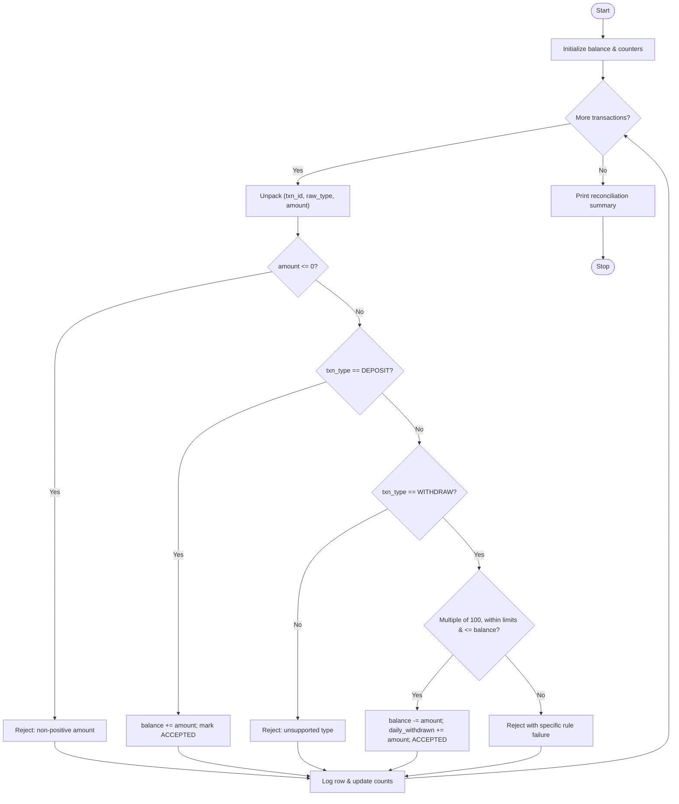
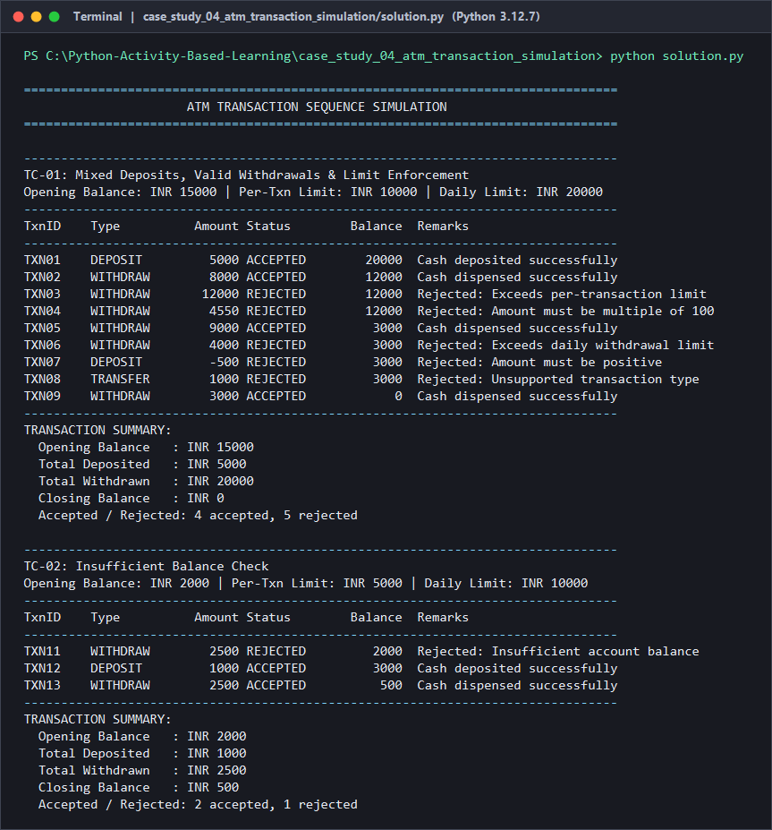

# Case Study 04: ATM Transaction Sequence Simulation (Question 13)

> **Syllabus Scope:** Variables, Data Types, Operators, Conditional Statements, Loops, Strings, Lists, Tuples, and Tuple Unpacking.

---

## 1. Problem Statement
Simulate an ATM transaction processor that handles a sequence of deposits and withdrawals, updates the account balance in real time, enforces per-transaction and daily withdrawal limits as well as denomination rules, rejects invalid operations with explicit reasons, and produces a reconciliation summary.

---

## 2. Objectives
- Process sequential `(txn_id, txn_type, amount)` tuples deterministically.
- Enforce positive amount validation, valid transaction types (`DEPOSIT`, `WITHDRAW`), `INR 100` withdrawal multiples, per-transaction limits, daily withdrawal caps, and sufficient balance checks.
- Preserve balance integrity whenever a transaction is rejected.
- Output a detailed transaction audit log and opening-to-closing balance summary.

---

## 3. Assumptions
- Transaction type strings may appear in mixed case and are normalized using `.strip().upper()`.
- Withdrawals are dispensed only in multiples of `INR 100`.
- Rejected transactions do not modify the account balance or `daily_withdrawn` total.

---

## 4. Algorithm
1. **Start** and iterate through each ATM scenario `(title, opening_balance, per_txn_limit, daily_limit, txns)`.
2. Initialize `balance = opening_balance`, `daily_withdrawn = 0`, `total_deposited = 0`, `accepted_count = 0`, `rejected_count = 0`.
3. For each `(txn_id, raw_type, amount)` in `txns`:
   - Normalize `txn_type = raw_type.strip().upper()`.
   - If `amount <= 0`, reject (`Amount must be positive`).
   - Else if `txn_type == "DEPOSIT"`, add `amount` to `balance` and `total_deposited`, mark `ACCEPTED`.
   - Else if `txn_type == "WITHDRAW"`:
     - Check `amount % 100 != 0`, `amount > per_txn_limit`, `daily_withdrawn + amount > daily_limit`, and `amount > balance`.
     - If all pass, subtract `amount` from `balance`, add to `daily_withdrawn`, mark `ACCEPTED`.
   - Else reject (`Unsupported transaction type`).
   - Print the transaction row with updated balance and remark.
4. Print the scenario reconciliation summary.
5. **Stop**.

---

## 5. Flowchart



---

## 6. Pseudocode

```text
BEGIN
    FOR EACH (title, opening_bal, per_txn_lim, daily_lim, txns) IN scenarios DO
        balance <- opening_bal
        daily_withdrawn <- 0
        total_deposited <- 0

        FOR EACH (txn_id, raw_type, amount) IN txns DO
            txn_type <- UPPER(STRIP(raw_type))
            IF amount <= 0 THEN
                STATUS <- "REJECTED"
            ELSE IF txn_type == "DEPOSIT" THEN
                balance <- balance + amount
                total_deposited <- total_deposited + amount
                STATUS <- "ACCEPTED"
            ELSE IF txn_type == "WITHDRAW" THEN
                IF amount MOD 100 == 0 AND amount <= per_txn_lim AND (daily_withdrawn + amount) <= daily_lim AND amount <= balance THEN
                    balance <- balance - amount
                    daily_withdrawn <- daily_withdrawn + amount
                    STATUS <- "ACCEPTED"
                ELSE
                    STATUS <- "REJECTED"
                END IF
            ELSE
                STATUS <- "REJECTED"
            END IF
            PRINT txn_id, txn_type, amount, STATUS, balance
        END FOR

        PRINT opening_bal, total_deposited, daily_withdrawn, balance
    END FOR
END
```

---

## 7. Python Source Code
- Source file: [`solution.py`](./solution.py)
- Uses only variables, conditionals, loops, strings, lists, tuples, and unpacking.

---

## 8. Test Cases

| Test ID | Scenario | Key Transactions Tested | Expected Outcome | Verification |
| :--- | :--- | :--- | :--- | :--- |
| **TC-01** | Mixed Ops & Limit Enforcement | Deposit `5000`; Withdraw `8000`, `12000` (>10k limit), `4550` (non-100), `9000`, `4000` (>20k daily), `-500`, `transfer`, `3000` | `4` accepted, `5` rejected; Closing balance `INR 0`, Withdrawn `INR 20000` | Passed |
| **TC-02** | Insufficient Balance Check | Start `2000`; Withdraw `2500` (fail), Deposit `1000`, Withdraw `2500` (pass) | `2` accepted, `1` rejected; Closing balance `INR 500` | Passed |

---

## 9. Output Screenshots



---

## 10. Conclusion
The ATM simulation faithfully enforces banking withdrawal rules, prevents invalid balance mutations, and produces an auditable sequence log with exact opening-to-closing reconciliation.
