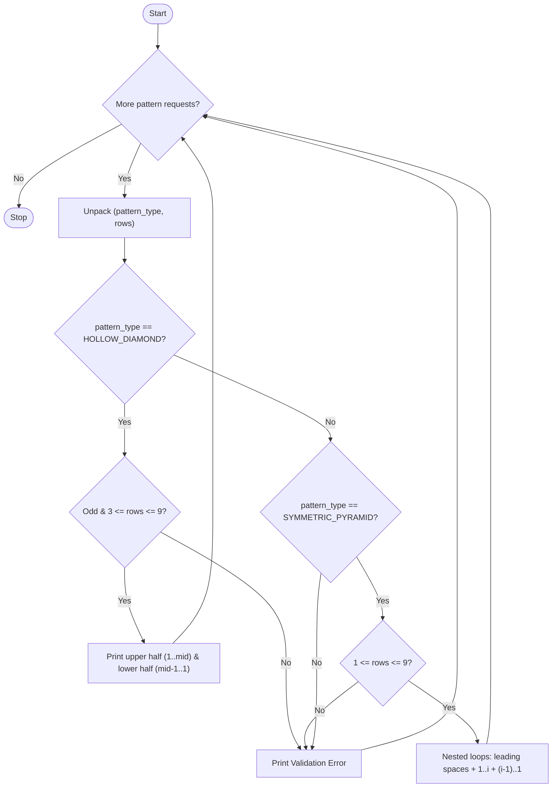
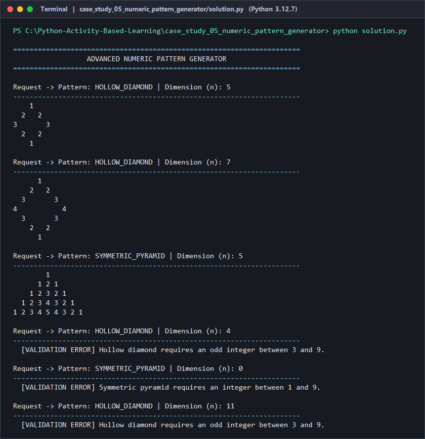

# Case Study 05: Advanced Numeric Pattern Generator (Question 27)

> **Syllabus Scope:** Variables, Data Types, Operators, Conditional Statements, Loops, Strings, Pattern Generation, Lists, Tuples, and Tuple Unpacking.

---

## 1. Problem Statement
Build a numeric pattern generator capable of producing both a **Hollow Numeric Diamond** and a **Symmetric Palindromic Numeric Pyramid** based on user-supplied dimensions, while validating invalid dimensions and maintaining exact horizontal alignment.

---

## 2. Objectives
- Generate symmetric hollow numeric diamonds for odd dimensions `n` (`3 <= n <= 9`).
- Generate centered palindromic numeric pyramids for dimensions `n` (`1 <= n <= 9`).
- Detect and report invalid dimensions (even counts for diamonds, non-positive values, or values exceeding single-digit alignment width).
- Demonstrate nested loop control and string spacing arithmetic.

---

## 3. Assumptions
- Maximum dimension is capped at `9` so every digit occupies a single character width and vertical symmetry remains exact.
- Hollow diamond requires an odd integer `n >= 3` so it has a single exact middle row (`mid = n // 2 + 1`).
- Each test request is stored as a tuple `(pattern_type, rows)`.

---

## 4. Algorithm
1. **Start** and iterate through each `(pattern_type, rows)` tuple in `test_requests`.
2. If `pattern_type == "HOLLOW_DIAMOND"`:
   - Validate `3 <= rows <= 9` and `rows % 2 == 1`. If invalid, print validation error and continue.
   - Compute `mid = (rows // 2) + 1`.
   - Loop `i` from `1` to `mid`:
     - Compute `leading_spaces = "  " * (mid - i)`.
     - If `i == 1`, print `leading_spaces + "1"`.
     - Else compute `inner_spaces = " " * (4 * i - 5)` and print `leading_spaces + str(i) + inner_spaces + str(i)`.
   - Loop `i` from `mid - 1` down to `1` with the same spacing formula to complete the lower half.
3. Else if `pattern_type == "SYMMETRIC_PYRAMID"`:
   - Validate `1 <= rows <= 9`. If invalid, print validation error and continue.
   - Loop `i` from `1` to `rows`:
     - Build line starting with `"  " * (rows - i)`, followed by ascending digits `1..i` and descending digits `i-1..1` separated by spaces.
4. Else print unsupported pattern error.
5. **Stop**.

---

## 5. Flowchart



---

## 6. Pseudocode

```text
BEGIN
    FOR EACH (pattern_type, rows) IN test_requests DO
        IF pattern_type == "HOLLOW_DIAMOND" THEN
            IF rows < 3 OR rows > 9 OR rows MOD 2 == 0 THEN
                PRINT "Validation Error"
                CONTINUE
            END IF
            mid <- (rows DIV 2) + 1
            FOR i <- 1 TO mid DO
                PRINT ("  " * (mid - i)) + (i IF i == 1 ELSE i + (" " * (4*i - 5)) + i)
            END FOR
            FOR i <- mid - 1 DOWNTO 1 DO
                PRINT ("  " * (mid - i)) + (i IF i == 1 ELSE i + (" " * (4*i - 5)) + i)
            END FOR
        ELSE IF pattern_type == "SYMMETRIC_PYRAMID" THEN
            IF rows < 1 OR rows > 9 THEN
                PRINT "Validation Error"
                CONTINUE
            END IF
            FOR i <- 1 TO rows DO
                line <- "  " * (rows - i)
                APPEND 1..i AND (i-1)..1 TO line
                PRINT line
            END FOR
        END IF
    END FOR
END
```

---

## 7. Python Source Code
- Source file: [`solution.py`](./solution.py)
- Uses only variables, arithmetic operators, conditionals, nested loops, strings, and tuple unpacking.

---

## 8. Test Cases

| Test ID | Pattern Type | Dimension `n` | Expected Outcome | Verification |
| :--- | :--- | :---: | :--- | :--- |
| **TC-01** | `HOLLOW_DIAMOND` | `5` | Perfectly aligned 5-row hollow diamond (`1` to `3` to `1`) | Passed |
| **TC-02** | `HOLLOW_DIAMOND` | `7` | Perfectly aligned 7-row hollow diamond (`1` to `4` to `1`) | Passed |
| **TC-03** | `SYMMETRIC_PYRAMID` | `5` | 5-row centered palindromic pyramid ending in `1 2 3 4 5 4 3 2 1` | Passed |
| **TC-04** | `HOLLOW_DIAMOND` | `4` | Validation error (even dimension rejected) | Passed |
| **TC-05** | `SYMMETRIC_PYRAMID` | `0` | Validation error (non-positive dimension rejected) | Passed |
| **TC-06** | `HOLLOW_DIAMOND` | `11` | Validation error (exceeds single-digit limit `9`) | Passed |

---

## 9. Output Screenshots



---

## 10. Conclusion
This case study demonstrates how mathematical row-spacing formulas and nested loops produce exact symmetric patterns while defensive input validation gracefully handles invalid user dimensions.
