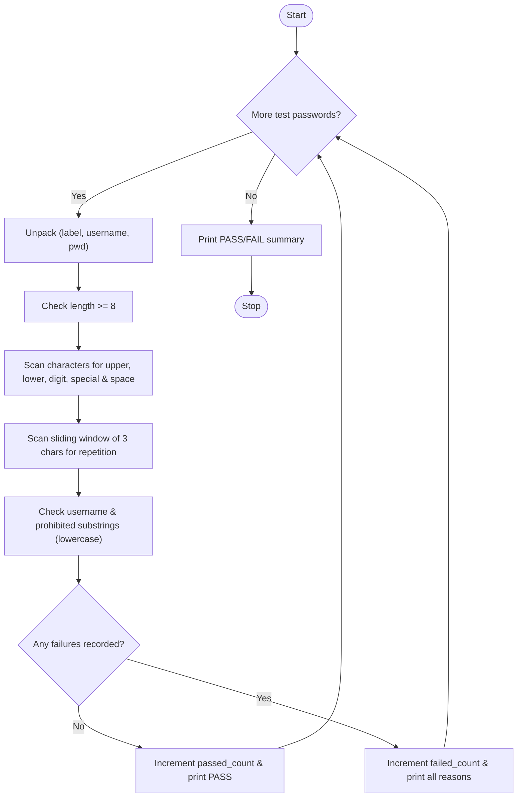
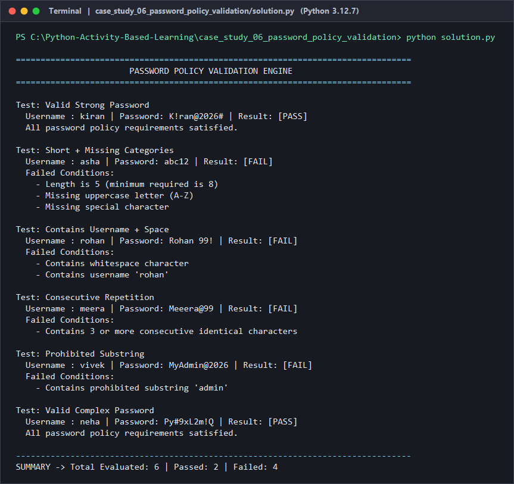

# Case Study 06: Password Policy Validation Engine (Question 29)

> **Syllabus Scope:** Variables, Data Types, Operators, Conditional Statements, Loops, Strings, Lists, Tuples, and Tuple Unpacking.

---

## 1. Problem Statement
Develop a rule-based password policy validation engine that evaluates candidate password strings against minimum length, character diversity (uppercase, lowercase, digit, special character), whitespace prohibition, consecutive character repetition, username inclusion, and prohibited dictionary substrings—explaining every failed condition.

---

## 2. Objectives
- Enforce minimum length (`>= 8` characters).
- Verify presence of at least one uppercase letter, lowercase letter, numeric digit, and special character, while rejecting spaces.
- Detect three or more identical consecutive characters (e.g., `eee`).
- Reject passwords containing the username or prohibited substrings (`password`, `admin`, `qwerty`, `1234`, `welcome`) case-insensitively.
- Report every violated rule rather than stopping at the first error.

---

## 3. Assumptions
- Each test entry is stored as a tuple `(label, username, password)`.
- Special characters belong to the string `"!@#$%^&*()-_=+[]{}|;:',.<>?/"`.
- Substring and username checks are case-insensitive using `.lower()`.

---

## 4. Algorithm
1. **Start** and define `MIN_LENGTH = 8`, `SPECIAL_CHARS`, and `PROHIBITED_WORDS`.
2. Initialize `passed_count = 0` and `failed_count = 0`.
3. For each `(label, username, pwd)` tuple in `test_passwords`:
   - Initialize `failures = []`.
   - Check `len(pwd) < MIN_LENGTH`; append message if violated.
   - Loop through each character `ch` in `pwd` to update boolean flags (`has_upper`, `has_lower`, `has_digit`, `has_special`, `has_space`).
   - Append failure messages for any missing category or space found.
   - Loop `i` from `0` to `len(pwd) - 3` to detect `pwd[i] == pwd[i + 1] == pwd[i + 2]`.
   - Convert `pwd` and `username` to lowercase; check if `lower_user` or any `bad_word` in `PROHIBITED_WORDS` occurs in `lower_pwd`.
   - Mark `PASS` if `len(failures) == 0`, else `FAIL` and print all failure reasons.
4. Print final evaluation summary (`Passed` vs `Failed`).
5. **Stop**.

---

## 5. Flowchart



---

## 6. Pseudocode

```text
BEGIN
    SET MIN_LENGTH <- 8
    SET passed_count <- 0, failed_count <- 0

    FOR EACH (label, username, pwd) IN test_passwords DO
        failures <- []
        IF LENGTH(pwd) < MIN_LENGTH THEN APPEND "Too short" TO failures

        SCAN pwd FOR has_upper, has_lower, has_digit, has_special, has_space
        APPEND missing category or whitespace errors TO failures

        FOR i <- 0 TO LENGTH(pwd) - 3 DO
            IF pwd[i] == pwd[i+1] AND pwd[i+1] == pwd[i+2] THEN
                APPEND "3+ consecutive identical characters" TO failures
                BREAK
            END IF
        END FOR

        IF LOWER(username) IN LOWER(pwd) THEN APPEND "Contains username" TO failures
        FOR EACH word IN PROHIBITED_WORDS DO
            IF word IN LOWER(pwd) THEN APPEND "Contains prohibited substring" TO failures
        END FOR

        IF LENGTH(failures) == 0 THEN
            passed_count <- passed_count + 1
            PRINT "PASS"
        ELSE
            failed_count <- failed_count + 1
            PRINT "FAIL", failures
        END IF
    END FOR
END
```

---

## 7. Python Source Code
- Source file: [`solution.py`](./solution.py)
- Uses only string indexing, string scanning loops, conditionals, lists, tuples, and unpacking.

---

## 8. Test Cases

| Test ID | Username | Password Tested | Expected Result | Failed Rules Reported | Verification |
| :--- | :--- | :--- | :---: | :--- | :--- |
| **TC-01** | `kiran` | `K!ran@2026#` | `PASS` | None | Passed |
| **TC-02** | `asha` | `abc12` | `FAIL` | Length < 8, missing uppercase, missing special char | Passed |
| **TC-03** | `rohan` | `Rohan 99!` | `FAIL` | Contains whitespace, contains username `'rohan'` | Passed |
| **TC-04** | `meera` | `Meeera@99` | `FAIL` | 3+ consecutive identical characters (`eee`) | Passed |
| **TC-05** | `vivek` | `MyAdmin@2026` | `FAIL` | Contains prohibited substring `'admin'` | Passed |
| **TC-06** | `neha` | `Py#9xL2m!Q` | `PASS` | None | Passed |

---

## 9. Output Screenshots



---

## 10. Conclusion
The Password Policy Validation Engine demonstrates comprehensive string inspection without regular expressions, giving users clear, actionable feedback on every violated security rule.
