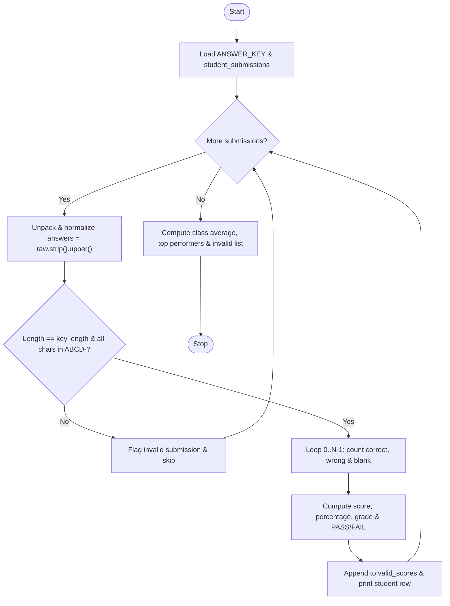
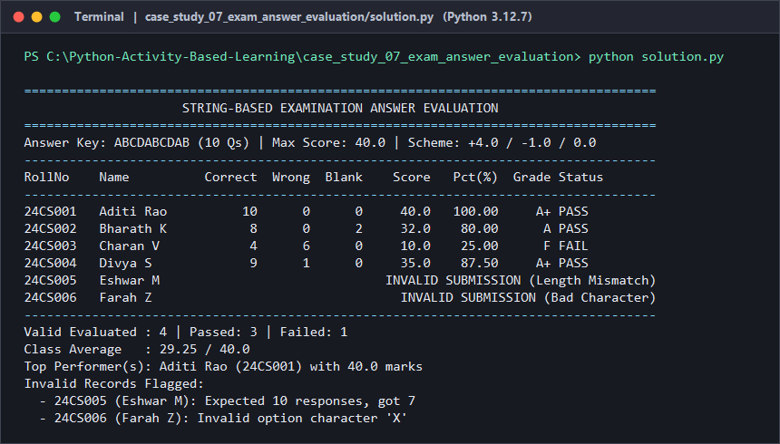

# Case Study 07: String-Based Examination Answer Evaluation (Question 31)

> **Syllabus Scope:** Variables, Data Types, Operators, Conditional Statements, Loops, Strings, Lists, Tuples, and Tuple Unpacking.

---

## 1. Problem Statement
Develop an automated examination grading system that compares student MCQ answer strings against a master answer key, counts correct, incorrect, and unanswered (`-`) responses, applies negative marking, validates malformed submissions, and produces student-wise results alongside class statistics.

---

## 2. Objectives
- Normalize answer strings and validate length alignment and allowed option characters (`A`, `B`, `C`, `D`, `-`).
- Compute per-student `correct`, `wrong`, `blank`, net `score`, percentage, grade (`A+` to `F`), and `PASS`/`FAIL` status.
- Flag malformed answer strings (length mismatches or invalid option characters) without crashing.
- Summarize class pass count, class average, and top performer(s).

---

## 3. Assumptions
- Answer key is `"ABCDABCDAB"` (10 questions).
- Marking scheme: `+4.0` for correct answer, `-1.0` for wrong answer, `0.0` for unanswered (`-`).
- Minimum passing percentage is `40.0%`; negative net scores clamp percentage display to `0.0%`.

---

## 4. Algorithm
1. **Start** and initialize `ANSWER_KEY`, marking scheme constants, and `student_submissions`.
2. Compute `total_questions = len(ANSWER_KEY)` and `max_score = total_questions * MARKS_CORRECT`.
3. For each `(roll_no, name, raw_answers)` in `student_submissions`:
   - Normalize `answers = raw_answers.strip().upper()`.
   - If `len(answers) != total_questions`, flag as length mismatch and `continue`.
   - Scan characters in `answers`; if any character is not in `"ABCD-"`, flag invalid character and `continue`.
   - Loop `i` from `0` to `total_questions - 1`: compare `answers[i]` with `ANSWER_KEY[i]` and increment `blank`, `correct`, or `wrong`.
   - Compute `score`, `pct`, `grade`, and `status`.
   - Append valid results to `valid_scores` and print the formatted student row.
4. Compute class average and identify top performer(s) from `valid_scores`, plus list any flagged invalid submissions.
5. **Stop**.

---

## 5. Flowchart



---

## 6. Pseudocode

```text
BEGIN
    SET ANSWER_KEY <- "ABCDABCDAB"
    SET max_score <- LENGTH(ANSWER_KEY) * 4.0

    FOR EACH (roll_no, name, raw_answers) IN student_submissions DO
        answers <- UPPER(STRIP(raw_answers))
        IF LENGTH(answers) != LENGTH(ANSWER_KEY) OR HAS_INVALID_CHAR(answers, "ABCD-") THEN
            APPEND (roll_no, name, error) TO invalid_records
            CONTINUE
        END IF

        correct <- 0, wrong <- 0, blank <- 0
        FOR i <- 0 TO LENGTH(ANSWER_KEY) - 1 DO
            IF answers[i] == "-" THEN blank <- blank + 1
            ELSE IF answers[i] == ANSWER_KEY[i] THEN correct <- correct + 1
            ELSE wrong <- wrong + 1
            END IF
        END FOR

        score <- (correct * 4.0) + (wrong * -1.0)
        pct <- MAX(0.0, (score / max_score) * 100.0)
        ASSIGN grade AND status
        PRINT formatted student result
    END FOR

    COMPUTE AND PRINT class average, top performers, and invalid_records
END
```

---

## 7. Python Source Code
- Source file: [`solution.py`](./solution.py)
- Uses only string indexing, string methods, loops, conditionals, lists, tuples, and unpacking.

---

## 8. Test Cases

| Roll No | Student | Answer String | Correct / Wrong / Blank | Expected Score & Result | Verification |
| :--- | :--- | :--- | :---: | :--- | :--- |
| `24CS001` | Aditi Rao | `ABCDABCDAB` | `10 / 0 / 0` | `40.0` (`100.00%`, `A+`, `PASS`) | Passed |
| `24CS002` | Bharath K | `abcdab--ab` | `8 / 0 / 2` | `32.0` (`80.00%`, `A`, `PASS`) | Passed |
| `24CS003` | Charan V | `AAAAABBBBB` | `4 / 6 / 0` | `10.0` (`25.00%`, `F`, `FAIL`) | Passed |
| `24CS004` | Divya S | `ABCDABCDAA` | `9 / 1 / 0` | `35.0` (`87.50%`, `A+`, `PASS`) | Passed |
| `24CS005` | Eshwar M | `ABCDABC` | N/A | Flagged: Length mismatch (`7` vs `10`) | Passed |
| `24CS006` | Farah Z | `ABCDXBCDAB` | N/A | Flagged: Invalid character `'X'` | Passed |

---

## 9. Output Screenshots



---

## 10. Conclusion
This case study proves how straightforward string indexing and character validation cleanly implement negative-marking OMR/answer-key evaluation with robust error reporting.
