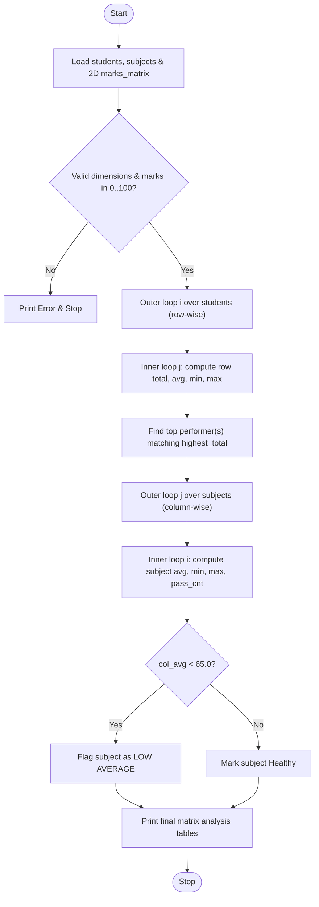
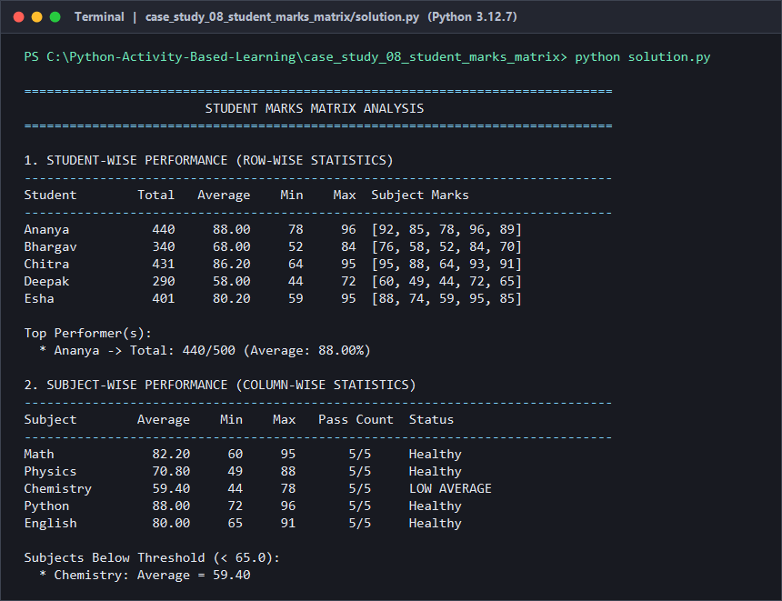

# Case Study 08: Student Marks Matrix Analysis (Question 42)

> **Syllabus Scope:** Variables, Data Types, Operators, Conditional Statements, Loops, Strings, Lists, Nested Lists, Tuples, and Tuple Unpacking.

---

## 1. Problem Statement
Analyse a 2D nested-list matrix of student marks across multiple academic subjects. Compute row-wise (student-level) and column-wise (subject-level) statistics, identify top-performing students (including ties), and detect subjects whose average score falls below a target threshold.

---

## 2. Objectives
- Store and validate a 2D matrix (`marks_matrix[student][subject]`) with bounds `0–100`.
- Compute row-wise `total`, `average`, `min`, and `max` for every student.
- Compute column-wise `average`, `min`, `max`, and `pass_count` (`>= 40`) for every subject.
- Identify top performer(s) and flag low-average subjects (`< 65.0`).

---

## 3. Assumptions
- Each row corresponds to one student in `students`; each column corresponds to one subject in `subjects`.
- Maximum mark per subject is `100`, and minimum pass mark is `40`.
- Subjects with a class average strictly below `65.0` are flagged as `"LOW AVERAGE"`.

---

## 4. Algorithm
1. **Start** and initialize `subjects`, `students`, and 2D nested list `marks_matrix`.
2. Validate that `len(marks_matrix) == len(students)`, every row has `len(subjects)` entries, and all marks are within `0..100`.
3. **Row-wise analysis**:
   - Loop `i` from `0` to `num_students - 1`:
     - Traverse `marks_matrix[i]` to compute `total`, `row_min`, `row_max`, and `avg = total / num_subjects`.
     - Track `highest_total` and store `(students[i], total, avg)` in `student_totals`.
   - Identify all students whose `total == highest_total`.
4. **Column-wise analysis**:
   - Loop `j` from `0` to `num_subjects - 1`:
     - Traverse `marks_matrix[i][j]` across all `i` to compute `col_total`, `col_min`, `col_max`, and `pass_cnt`.
     - Compute `col_avg = col_total / num_students`.
     - If `col_avg < LOW_SUBJECT_AVG_THRESHOLD`, flag subject as `"LOW AVERAGE"`.
5. Display both summary tables, top performers, and low-average subjects.
6. **Stop**.

---

## 5. Flowchart



---

## 6. Pseudocode

```text
BEGIN
    VALIDATE len(marks_matrix) == len(students) AND all marks in 0..100

    highest_total <- -1
    FOR i <- 0 TO num_students - 1 DO
        total <- 0, rmin <- matrix[i][0], rmax <- matrix[i][0]
        FOR j <- 0 TO num_subjects - 1 DO
            val <- matrix[i][j]
            total <- total + val
            UPDATE rmin, rmax
        END FOR
        avg <- total / num_subjects
        APPEND (students[i], total, avg) TO student_totals
        IF total > highest_total THEN highest_total <- total
        PRINT student row
    END FOR

    FOR j <- 0 TO num_subjects - 1 DO
        col_total <- 0, cmin <- matrix[0][j], cmax <- matrix[0][j], pass_cnt <- 0
        FOR i <- 0 TO num_students - 1 DO
            val <- matrix[i][j]
            col_total <- col_total + val
            UPDATE cmin, cmax
            IF val >= PASS_MARK THEN pass_cnt <- pass_cnt + 1
        END FOR
        col_avg <- col_total / num_students
        FLAG subject IF col_avg < 65.0
        PRINT subject row
    END FOR
END
```

---

## 7. Python Source Code
- Source file: [`solution.py`](./solution.py)
- Uses only nested lists, nested `for` loops, conditionals, tuples, and unpacking.

---

## 8. Test Cases

| Scope | Sample Data Highlights | Expected Results | Verification |
| :--- | :--- | :--- | :--- |
| **Row-wise (Students)** | Ananya `[92,85,78,96,89]`, Chitra `[95,88,64,93,91]`, Deepak `[60,49,44,72,65]` | Ananya top performer (`440/500`, `88.00%`); Chitra `431` (`86.20%`); Deepak `290` (`58.00%`) | Passed |
| **Column-wise (Subjects)** | `Chemistry` scores `[78,52,64,44,59]`; `Python` scores `[96,84,93,72,95]` | `Chemistry` flagged `LOW AVERAGE` (`59.40`); `Python` highest avg (`88.00`); all `5/5` pass | Passed |

---

## 9. Output Screenshots



---

## 10. Conclusion
Nested lists and nested iteration enable clean row-wise and column-wise matrix analytics, making it easy to pinpoint both standout students and underperforming subjects in a single pass.
