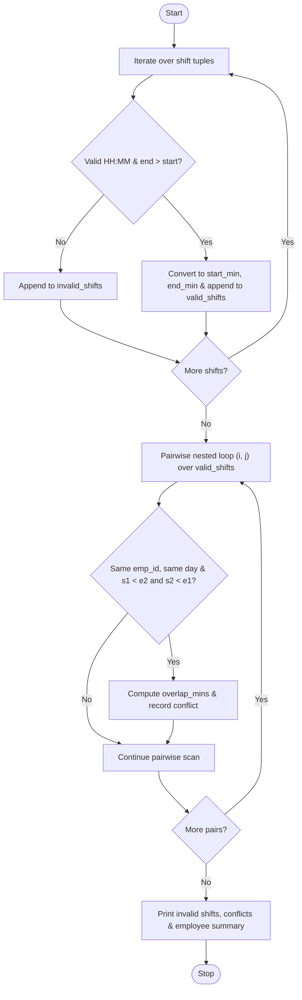
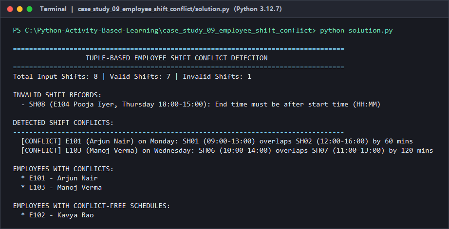

# Case Study 09: Tuple-Based Employee Shift Conflict Detection (Question 48)

> **Syllabus Scope:** Variables, Data Types, Operators, Conditional Statements, Loops, Strings, Lists, Tuples, Tuple Operations, and Tuple Unpacking.

---

## 1. Problem Statement
Represent employee work shifts as tuples `(shift_id, emp_id, emp_name, day, start_hhmm, end_hhmm)`. Parse and validate shift intervals, compare time ranges across assignments, detect overlapping shifts on the same day for the same employee, and list both conflicting and conflict-free employees.

---

## 2. Objectives
- Parse `"HH:MM"` strings into integer minutes since midnight (`0–1439`) using string splitting and validation.
- Reject invalid shifts where `end_time <= start_time` or time components are out of range.
- Detect overlapping half-open intervals `[start1, end1)` and `[start2, end2)` while allowing exact back-to-back shifts (`12:00` end and `12:00` start).
- Compute exact overlap duration in minutes and summarize conflicting vs clean employee schedules.

---

## 3. Assumptions
- Each shift starts and ends within the same calendar day (`00:00` to `23:59`).
- Back-to-back shifts sharing an exact boundary (`08:00–12:00` and `12:00–16:00`) do **not** conflict (`s1 < e2 and s2 < e1`).
- Day comparisons are case-insensitive.

---

## 4. Algorithm
1. **Start** and initialize `valid_shifts = []`, `invalid_shifts = []`.
2. For each shift tuple `(shift_id, emp_id, emp_name, day, start_str, end_str)`:
   - Split `start_str` and `end_str` on `":"`; verify both parts are digits within `0..23` hours and `0..59` minutes.
   - Convert to `start_min` and `end_min`; verify `end_min > start_min`.
   - Append valid tuples (with `start_min, end_min`) to `valid_shifts`, else append to `invalid_shifts`.
3. Perform pairwise nested-loop comparison over `valid_shifts` (`i` from `0` to `n-1`, `j` from `i+1` to `n-1`):
   - If `emp_id` matches and `day.lower()` matches:
     - Check overlap condition `s1_min < e2_min and s2_min < e1_min`.
     - If overlapping, compute `overlap_mins = min(e1, e2) - max(s1, s2)`, record conflict, and add employee to `conflicting_employees`.
4. Collect all valid employees not in `conflicting_employees` into `clean_employees`.
5. Print invalid shifts, detected conflicts, conflicting employees, and conflict-free employees.
6. **Stop**.

---

## 5. Flowchart



---

## 6. Pseudocode

```text
BEGIN
    valid_shifts <- []
    invalid_shifts <- []

    FOR EACH (sid, eid, ename, day, st, en) IN shifts DO
        PARSE st, en INTO start_min, end_min
        IF valid format AND end_min > start_min THEN
            APPEND (sid, eid, ename, day, st, en, start_min, end_min) TO valid_shifts
        ELSE
            APPEND shift TO invalid_shifts
        END IF
    END FOR

    FOR i <- 0 TO LENGTH(valid_shifts) - 1 DO
        FOR j <- i + 1 TO LENGTH(valid_shifts) - 1 DO
            IF same emp_id AND same day AND s1_min < e2_min AND s2_min < e1_min THEN
                overlap <- MIN(e1_min, e2_min) - MAX(s1_min, s2_min)
                RECORD conflict
            END IF
        END FOR
    END FOR

    PRINT invalid_shifts, conflicts, conflicting_employees, clean_employees
END
```

---

## 7. Python Source Code
- Source file: [`solution.py`](./solution.py)
- Uses only tuples, tuple unpacking, string splitting, nested loops, lists, and conditionals.

---

## 8. Test Cases

| Shift IDs | Employee | Day & Times | Expected Outcome | Verification |
| :--- | :--- | :--- | :--- | :--- |
| `SH01`, `SH02` | `E101` (Arjun Nair) | Monday `09:00–13:00` & `12:00–16:00` | Conflict detected (`60` mins overlap) | Passed |
| `SH03` | `E101` (Arjun Nair) | Tuesday `09:00–13:00` | No conflict (different day) | Passed |
| `SH04`, `SH05` | `E102` (Kavya Rao) | Monday `08:00–12:00` & `12:00–16:00` | Conflict-free (exact boundary touch) | Passed |
| `SH06`, `SH07` | `E103` (Manoj Verma) | Wednesday `10:00–14:00` & `11:00–13:00` | Conflict detected (`120` mins nested overlap) | Passed |
| `SH08` | `E104` (Pooja Iyer) | Thursday `18:00–15:00` | Flagged invalid (`end <= start`) | Passed |

---

## 9. Output Screenshots



---

## 10. Conclusion
Representing shift records as immutable tuples paired with minute-level interval arithmetic cleanly detects partial and nested scheduling overlaps while preserving back-to-back shifts.
