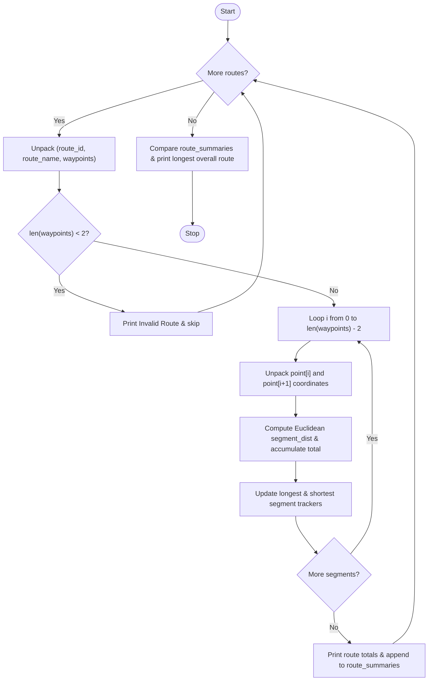
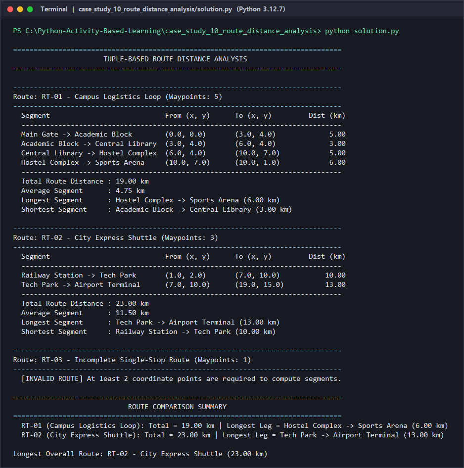

# Case Study 10: Tuple-Based Route Distance Analysis (Question 50)

> **Syllabus Scope:** Variables, Data Types, Operators, Conditional Statements, Loops, Strings, Lists, Tuples, Tuple Operations, and Tuple Unpacking.

---

## 1. Problem Statement
Store sequences of geographical waypoints as coordinate tuples `(point_name, x_km, y_km)`, calculate the distance between every pair of consecutive waypoints using the 2D Euclidean distance formula, compute total and average leg distances per route, and identify the longest route segment and longest overall route.

---

## 2. Objectives
- Represent multi-stop routes as lists of coordinate tuples.
- Unpack consecutive coordinate tuples `(p1_name, x1, y1)` and `(p2_name, x2, y2)` cleanly inside loops.
- Compute segment distance using pure arithmetic operators (`((x2 - x1)**2 + (y2 - y1)**2) ** 0.5`) without external math imports.
- Validate routes with fewer than 2 waypoints and identify both the longest/shortest segment per route and the longest overall route.

---

## 3. Assumptions
- Coordinates `(x_km, y_km)` represent planar Cartesian coordinates measured in kilometers (`km`).
- Distance between two consecutive points uses the standard Euclidean formula `sqrt((x2 - x1)^2 + (y2 - y1)^2)`.
- A valid route requires at least `2` waypoints (`>= 1` segment).

---

## 4. Algorithm
1. **Start** and initialize `routes` and `route_summaries = []`.
2. For each route tuple `(route_id, route_name, waypoints)`:
   - If `len(waypoints) < 2`, print invalid route message and `continue`.
   - Initialize `total_distance = 0.0`, `longest_distance = -1.0`, `shortest_distance = -1.0`.
   - Loop `i` from `0` to `len(waypoints) - 2`:
     - Unpack `p1_name, x1, y1 = waypoints[i]` and `p2_name, x2, y2 = waypoints[i + 1]`.
     - Compute `dx = x2 - x1`, `dy = y2 - y1`, and `segment_dist = ((dx * dx) + (dy * dy)) ** 0.5`.
     - Add `segment_dist` to `total_distance` and print the segment row.
     - Update `longest_distance` / `longest_segment_name` and `shortest_distance` / `shortest_segment_name`.
   - Compute `avg_segment = total_distance / (len(waypoints) - 1)`, display route metrics, and append summary tuple to `route_summaries`.
3. Compare all entries in `route_summaries` to report the longest overall route.
4. **Stop**.

---

## 5. Flowchart



---

## 6. Pseudocode

```text
BEGIN
    route_summaries <- []

    FOR EACH (route_id, route_name, waypoints) IN routes DO
        IF LENGTH(waypoints) < 2 THEN
            PRINT "INVALID ROUTE"
            CONTINUE
        END IF

        total_dist <- 0.0, longest <- -1.0, shortest <- -1.0
        FOR i <- 0 TO LENGTH(waypoints) - 2 DO
            (p1, x1, y1) <- waypoints[i]
            (p2, x2, y2) <- waypoints[i + 1]
            dist <- ((x2 - x1)^2 + (y2 - y1)^2) ^ 0.5
            total_dist <- total_dist + dist
            UPDATE longest AND shortest segment
            PRINT segment row
        END FOR

        APPEND (route_id, route_name, total_dist, longest_seg, longest) TO route_summaries
        PRINT route summary
    END FOR

    FIND AND PRINT route with maximum total_dist
END
```

---

## 7. Python Source Code
- Source file: [`solution.py`](./solution.py)
- Uses only tuples, tuple unpacking, arithmetic operators, loops, conditionals, and lists.

---

## 8. Test Cases

| Route ID | Route Name | Waypoints | Expected Total | Expected Longest Segment | Verification |
| :--- | :--- | :---: | :---: | :--- | :--- |
| `RT-01` | Campus Logistics Loop | 5 stops (`5 + 3 + 5 + 6`) | `19.00 km` | `Hostel Complex -> Sports Arena` (`6.00 km`) | Passed |
| `RT-02` | City Express Shuttle | 3 stops (`10 + 13`) | `23.00 km` | `Tech Park -> Airport Terminal` (`13.00 km`) | Passed |
| `RT-03` | Incomplete Single-Stop | 1 stop | Rejected | Validation error (`< 2` waypoints) | Passed |

---

## 9. Output Screenshots



---

## 10. Conclusion
Tuple unpacking combined with basic arithmetic provides a clean, zero-dependency implementation for geometric route segmentation, distance aggregation, and bottleneck-leg identification.
